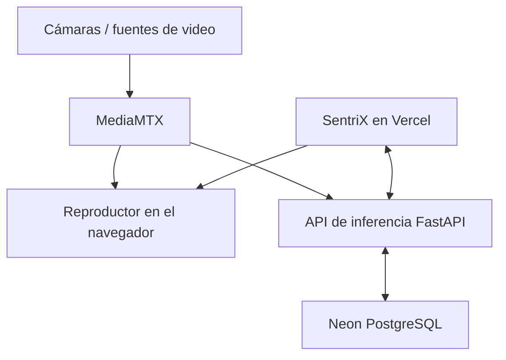

<p align="center">
  
</p>

<h1 align="center">SentriX Surveillance</h1>

<p align="center">
  Centro web de monitoreo para administrar cámaras, visualizar transmisiones y consultar detecciones, alertas y métricas de inferencia.
</p>

<p align="center">
  <a href="https://sentryx-surveillance.vercel.app/"><strong>Ver aplicación desplegada</strong></a>
</p>

> SentriX es un prototipo académico. Sus resultados deben ser revisados por una persona y no deben utilizarse como único fundamento para tomar decisiones policiales, legales, laborales o de seguridad.

## Descripción

SentriX centraliza la supervisión de cámaras conectadas a una infraestructura de streaming e inferencia. La interfaz permite registrar cámaras, iniciar o reintentar su procesamiento, observar el video en vivo y revisar la actividad producida por el servicio de análisis.

Este repositorio contiene la aplicación web. La inferencia, el acceso a los streams y la persistencia se realizan mediante servicios externos configurados por variables de entorno.

## Funcionalidades principales

- Panel general con cámaras activas, transmisiones, detecciones del día y alertas.
- Registro, activación, reintento y eliminación de cámaras.
- Reproducción de transmisiones WebRTC servidas por MediaMTX.
- Consulta de detecciones y alertas generadas por el backend.
- Historial con filtros por clase y rango de fechas.
- Visualización de métricas operativas: frames recibidos, ventanas procesadas, latencia y antigüedad del último frame.
- Registro de eventos del servicio con búsqueda, filtros y paginación.
- Actualización periódica del estado del sistema.

## Arquitectura



La aplicación SvelteKit consume FastAPI por medio de rutas ejecutadas del lado del servidor. De esta forma, la clave de la API no se expone en el navegador. La conexión con Neon pertenece al backend de inferencia; este frontend no se conecta directamente a la base de datos.

## Tecnologías

| Componente | Tecnología |
|---|---|
| Aplicación web | Svelte 5 y SvelteKit 3 |
| Lenguaje | JavaScript y TypeScript |
| Herramientas de desarrollo | Vite 8 |
| Despliegue web | Vercel |
| API de inferencia | FastAPI |
| Streaming | MediaMTX / WebRTC |
| Base de datos | Neon PostgreSQL, administrada por el backend |

## Estructura del repositorio

```text
.
├── src/
│   ├── lib/
│   │   └── server/          # Integración privada con FastAPI
│   ├── routes/
│   │   ├── api/             # Endpoints internos de SvelteKit
│   │   └── +page.svelte     # Panel principal
│   └── env.js               # Lectura y validación de configuración
├── static/                  # Recursos públicos y logotipo
├── .env.example             # Plantilla de variables de entorno
├── package.json
└── vite.config.js
```

## Requisitos

- Node.js y npm compatibles con las dependencias del proyecto.
- Una instancia accesible del servicio FastAPI.
- Un servidor MediaMTX accesible desde el navegador.
- La configuración de Neon debe existir en el backend, no en este repositorio.

## Instalación local

1. Entra en el directorio del proyecto e instala las versiones registradas en el archivo de bloqueo:

```bash
cd sentryx-surveillance-main
npm ci
```

2. Crea el archivo de configuración local.

Linux o macOS:

```bash
cp .env.example .env
```

Windows PowerShell:

```powershell
Copy-Item .env.example .env
```

3. Completa las variables de entorno:

```dotenv
INFERENCE_API_URL=https://api-inferencia.ejemplo.com
INFERENCE_API_KEY=clave_privada
CAMERA_PLAYBACK_URL=https://stream.ejemplo.com/RUTA_DE_CAMARA/
```

| Variable | Uso |
|---|---|
| `INFERENCE_API_URL` | URL base del servicio FastAPI. |
| `INFERENCE_API_KEY` | Clave enviada al backend mediante el encabezado `X-API-Key`. |
| `CAMERA_PLAYBACK_URL` | URL base usada para construir la reproducción de cada cámara en MediaMTX. |

4. Inicia el servidor de desarrollo:

```bash
npm run dev
```

La aplicación quedará disponible en la dirección local indicada por Vite.

## Comandos disponibles

| Comando | Descripción |
|---|---|
| `npm run dev` | Inicia el entorno de desarrollo. |
| `npm run build` | Genera la versión de producción. |
| `npm run preview` | Sirve localmente la compilación de producción. |
| `npm run check` | Ejecuta las comprobaciones de Svelte y TypeScript. |

Antes de publicar cambios se recomienda ejecutar:

```bash
npm run check
npm run build
```

## Integración esperada con FastAPI

El frontend utiliza los siguientes recursos del servicio de inferencia:

| Recurso | Propósito |
|---|---|
| `/health` | Consultar la disponibilidad del servicio. |
| `/cameras` | Registrar, listar y administrar cámaras. |
| `/sources/start` | Iniciar el procesamiento de una fuente. |
| `/sources/{id}/status` | Consultar el estado de una fuente. |
| `/detections` | Recuperar el historial de detecciones. |
| `/alerts` | Recuperar alertas generadas. |
| `/inference-logs` | Consultar registros técnicos del servicio. |

Las respuestas exactas y la persistencia en Neon son responsabilidad del backend. Si FastAPI no está disponible, el sitio puede cargar, pero las funciones de monitoreo e inferencia aparecerán sin conexión.

## Despliegue en Vercel

1. Importa el repositorio en Vercel.
2. Configura las tres variables de entorno indicadas anteriormente.
3. Ejecuta el despliegue con el comando de construcción detectado desde `package.json`.
4. Comprueba que la API de inferencia sea accesible desde Vercel.
5. Verifica que las URLs de reproducción sean accesibles por HTTPS desde el navegador para evitar bloqueos por contenido mixto.

Despliegue actual: [sentryx-surveillance.vercel.app](https://sentryx-surveillance.vercel.app/)

## Seguridad y limitaciones

- No subas el archivo `.env` ni claves reales al repositorio.
- Mantén `INFERENCE_API_KEY` únicamente en variables privadas del servidor y de Vercel.
- Utiliza HTTPS para la API y las transmisiones en ambientes publicados.
- El sistema depende de la disponibilidad de FastAPI, MediaMTX y Neon.
- La precisión del sistema depende del modelo y de las condiciones de las cámaras.
- La versión actual es un prototipo y todavía requiere controles adicionales de autenticación, autorización, auditoría y protección de datos antes de un uso operativo.

## Estado del proyecto

- Aplicación web desplegada en Vercel.
- Panel de monitoreo y administración de cámaras implementado.
- Integración con MediaMTX y FastAPI preparada mediante variables de entorno.
- Persistencia desplegada en Neon a través del backend.
- Pendiente: reforzar autenticación, autorización, observabilidad y validación en escenarios reales.

## Licencia

Este repositorio no incluye actualmente una licencia de distribución. Hasta que se añada una, el código debe considerarse de uso reservado por sus autores.

## Backend de inferencia SentriX

El frontend SvelteKit permanece en la raíz (`src/`, `static/`, `package.json`).
El backend Python está en `backend/`, y los adaptadores/metadatos de VideoMAE
en `modelo/`. Los pesos se distribuyen aparte.

- [Instalación, ejecución y pruebas del backend](backend/README.md)
- [Modelo y obtención de pesos](modelo/README.md)

La configuración privada del backend vive en `backend/.env`; el `.env` de la
raíz pertenece al frontend. Ninguno se versiona. Ejecutar un único proceso del
backend. Las rutas WebRTC directas corresponden al modo alternativo explícito.
